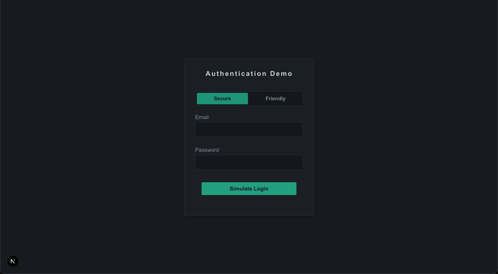

# Secure Login UX Case Study

A small frontend case study exploring how authentication feedback affects UX and security.

<p align="center">
  
</p>

---

## What it is

A simulated login flow with two feedback modes:

- **Friendly** – specific, helpful messages
- **Secure** – generic, intentionally vague messages

Same input, same auth result, different message depending on mode.

---

## Try it

```bash
npm install
npm run dev
```

**Test credentials**

| Scenario | Email | Password |
|---|---|---|
| Valid login | `demo@example.com` | `Password123` |
| Wrong password | `demo@example.com` | anything else |
| Account not found | any other email | anything |
| Too many attempts | — | repeat failed attempts |

Switch between **Friendly** and **Secure** to compare feedback.

---

## Project structure

```
lib/
  fake-auth.ts            # Simulates auth responses
  auth-message-policy.ts  # Maps results to user-facing messages
  validation.ts
  types.ts
components/
  login/
    login-form.tsx        # Main form logic
    mode-toggle.tsx
    feedback-message.tsx
```